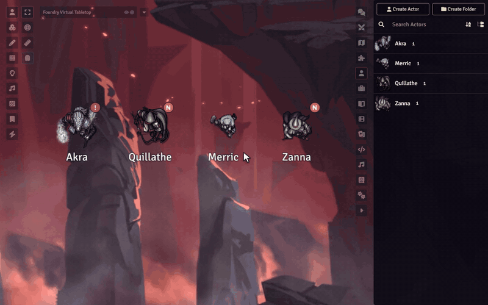

# Sephral’s Player Notes

**The bard still owes the smith 50 gold. The rogue's sister is alive. You promised the paladin a scene of her own.** Player Notes keeps all of it right on the characters, so nothing slips through between sessions.

## Highlights

* **Notes where they belong:** private GM notes on every player character, one click away from the sheet, the actor directory or the token HUD.
* **Made for campaign memory:** story hooks, secrets, promises, debts, unresolved scenes and spotlight reminders.
* **Know what is due:** statuses like *Open* and *Next Session*, priorities from *Low* to *Urgent* and tags of your own.
* **One dashboard for the whole party:** filter by character, status, tag or priority, or switch to the session prep view before game night.
* **Reminders at a glance:** the actor directory, and the tokens if you like, show who has urgent notes or notes for the next session.
* **Session prep to go:** export your prep as Markdown or back up everything as JSON. Imports show a preview first.

## How it works

1. Open a character's notes from the sheet header, the actor directory or the token HUD.
2. Write the note and set a status and a priority.
3. Before the next session, open the dashboard and see everything that is due.

## Good to know

Players never see the notes in any window of the module. The notes are stored on the actor without encryption, though, so a player who knows the browser console could read them. Keep anything players must never find out somewhere else.

## Install

Search for **Player Notes** in Foundry's module browser or open the [package page](https://foundryvtt.com/packages/sephrals-player-notes).

Foundry VTT v13 and v14 · any game system · English and German

## Learn more

The [manual](MANUAL.md) covers every view of the dashboard, export and import, how notes are stored and the macro API.

Questions or ideas? Join us on [Discord](https://discord.gg/7BjCgDYaBP). Looking for more? See [all modules by Sephral](https://github.com/Sephral).

## License

See [LICENSE.md](LICENSE.md).
